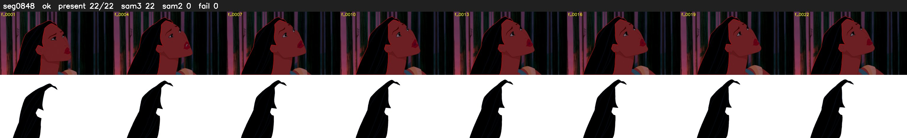

# Segment 848 (shot)

Film frames 74387-74408 (22 frames, 52:42.6-52:43.5).

**Status: ok**

| | |
|---|---|
| Frames with her hair | 22 / 22 |
| Mask source | SAM3 22, SAM2 fallback 0 |
| Frames still failing QC | 0 [] |
| Film indices with no picture (held) | 0 |
| Time | 32 s |

Top: source with the final mask outlined in red. Bottom: white-fill output.
