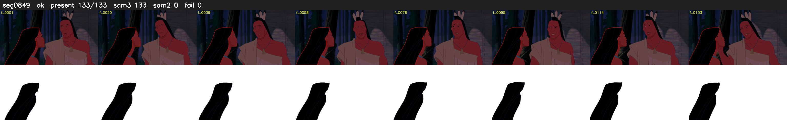

# Segment 849 (shot)

Film frames 74409-74541 (133 frames, 52:43.5-52:49.0).

**Status: ok**

| | |
|---|---|
| Frames with her hair | 133 / 133 |
| Mask source | SAM3 133, SAM2 fallback 0 |
| Frames still failing QC | 0 [] |
| Film indices with no picture (held) | 0 |
| Time | 272 s |

Top: source with the final mask outlined in red. Bottom: white-fill output.

## Issues

- dark scene: 100% of frames fail 'missed', missed QC off
- other characters' hair erased on 133 frames
