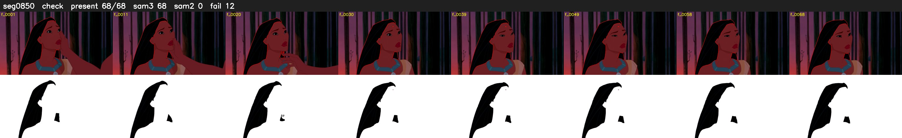

# Segment 850 (shot)

Film frames 74542-74609 (68 frames, 52:49.0-52:51.9).

**Status: check**

| | |
|---|---|
| Frames with her hair | 68 / 68 |
| Mask source | SAM3 68, SAM2 fallback 0 |
| Frames still failing QC | 12 [1, 2, 3, 4, 5, 6, 7, 8, 9, 10, 11, 12] |
| Film indices with no picture (held) | 0 |
| Time | 106 s |

Top: source with the final mask outlined in red. Bottom: white-fill output.
