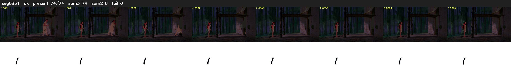

# Segment 851 (shot)

Film frames 74610-74683 (74 frames, 52:51.9-52:54.9).

**Status: ok**

| | |
|---|---|
| Frames with her hair | 74 / 74 |
| Mask source | SAM3 74, SAM2 fallback 0 |
| Frames still failing QC | 0 [] |
| Film indices with no picture (held) | 0 |
| Time | 125 s |

Top: source with the final mask outlined in red. Bottom: white-fill output.

## Issues

- other characters' hair erased on 2 frames
