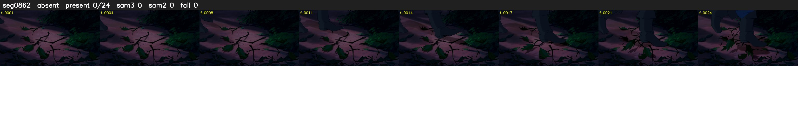

# Segment 862 (shot)

Film frames 75578-75601 (24 frames, 53:32.2-53:33.2).

**Status: absent**

| | |
|---|---|
| Frames with her hair | 0 / 24 |
| Mask source | SAM3 0, SAM2 fallback 0 |
| Frames still failing QC | 0 [] |
| Film indices with no picture (held) | 0 |
| Time | 7 s |

Top: source with the final mask outlined in red. Bottom: white-fill output.

## Issues

- hair on 1/4 presence frames, none of it hers (best P 0.00)
