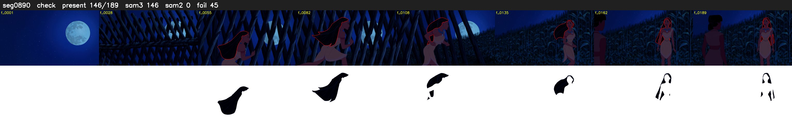

# Segment 890 (shot)

Film frames 77873-78061 (189 frames, 54:08.0-54:15.8).

**Status: check**

| | |
|---|---|
| Frames with her hair | 146 / 189 |
| Mask source | SAM3 146, SAM2 fallback 0 |
| Frames still failing QC | 45 [44, 126, 133, 134, 135, 136, 137, 138, 139, 140, 141, 142, 143, 144, 145, 146, 147, 148, 149, 150] |
| Film indices with no picture (held) | 0 |
| Time | 305 s |

Top: source with the final mask outlined in red. Bottom: white-fill output.

## Issues

- other characters' hair erased on 47 frames
