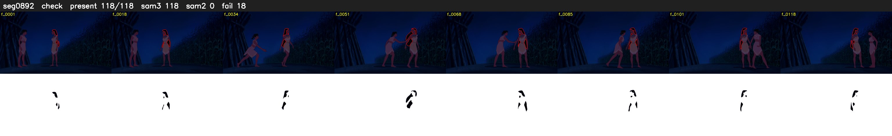

# Segment 892 (shot)

Film frames 78143-78260 (118 frames, 54:19.2-54:24.1).

**Status: check**

| | |
|---|---|
| Frames with her hair | 118 / 118 |
| Mask source | SAM3 118, SAM2 fallback 0 |
| Frames still failing QC | 18 [59, 60, 61, 62, 63, 64, 65, 66, 67, 68, 71, 72, 75, 76, 77, 78, 91, 94] |
| Film indices with no picture (held) | 0 |
| Time | 241 s |

Top: source with the final mask outlined in red. Bottom: white-fill output.

## Issues

- other characters' hair erased on 113 frames
