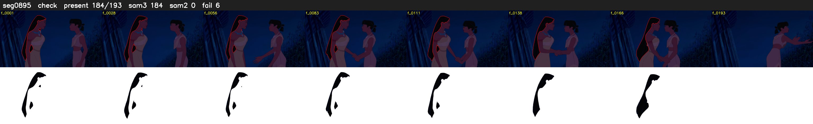

# Segment 895 (shot)

Film frames 78364-78556 (193 frames, 54:28.4-55:36.5).

**Status: check**

| | |
|---|---|
| Frames with her hair | 184 / 193 |
| Mask source | SAM3 184, SAM2 fallback 0 |
| Frames still failing QC | 6 [173, 174, 175, 176, 177, 184] |
| Film indices with no picture (held) | 0 |
| Time | 393 s |

Top: source with the final mask outlined in red. Bottom: white-fill output.

## Issues

- other characters' hair erased on 188 frames
