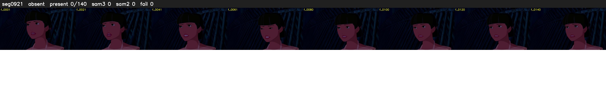

# Segment 921 (shot)

Film frames 80524-80663 (140 frames, 56:58.5-56:04.4).

**Status: absent**

| | |
|---|---|
| Frames with her hair | 0 / 140 |
| Mask source | SAM3 0, SAM2 fallback 0 |
| Frames still failing QC | 0 [] |
| Film indices with no picture (held) | 0 |
| Time | 46 s |

Top: source with the final mask outlined in red. Bottom: white-fill output.

## Issues

- hair on 24/24 presence frames, none of it hers (best P 0.01)
