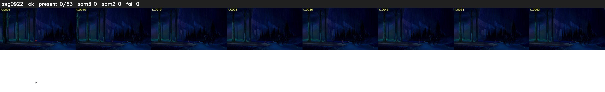

# Segment 922 (shot)

Film frames 80664-80726 (63 frames, 56:04.4-56:07.0).

**Status: ok**

| | |
|---|---|
| Frames with her hair | 0 / 63 |
| Mask source | SAM3 0, SAM2 fallback 0 |
| Frames still failing QC | 0 [] |
| Film indices with no picture (held) | 0 |
| Time | 108 s |

Top: source with the final mask outlined in red. Bottom: white-fill output.

## Issues

- other characters' hair erased on 25 frames
