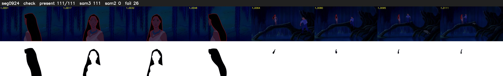

# Segment 924 (shot)

Film frames 80802-80912 (111 frames, 56:10.1-56:14.7).

**Status: check**

| | |
|---|---|
| Frames with her hair | 111 / 111 |
| Mask source | SAM3 111, SAM2 fallback 0 |
| Frames still failing QC | 26 [55, 70, 80, 81, 83, 84, 86, 87, 94, 95, 96, 97, 98, 99, 100, 101, 102, 103, 104, 105] |
| Film indices with no picture (held) | 0 |
| Time | 175 s |

Top: source with the final mask outlined in red. Bottom: white-fill output.

## SAM2 fallbacks

| Frames | Anchor | Direction | SAM2 used |
|---|---|---|---|
| 55-55 | 54 | forward | 0/1 |

## Issues

- fallback 70-70: no seed prompts (cleaned seed too small (2847 px): hair lost)
- fallback 80-81: no seed prompts (cleaned seed too small (2535 px): hair lost)
- fallback 83-84: no seed prompts (cleaned seed too small (2342 px): hair lost)
- fallback 86-87: no seed prompts (cleaned seed too small (2682 px): hair lost)
- fallback 94-111: no seed prompts (cleaned seed too small (2236 px): hair lost)
