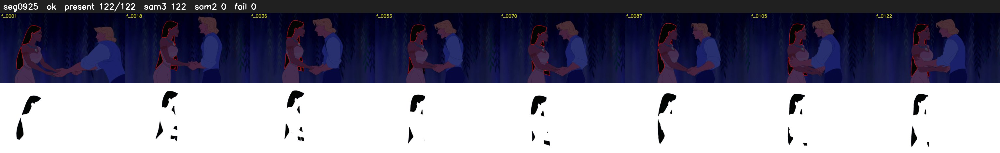

# Segment 925 (shot)

Film frames 80913-81034 (122 frames, 56:14.7-56:19.8).

**Status: ok**

| | |
|---|---|
| Frames with her hair | 122 / 122 |
| Mask source | SAM3 122, SAM2 fallback 0 |
| Frames still failing QC | 0 [] |
| Film indices with no picture (held) | 0 |
| Time | 187 s |

Top: source with the final mask outlined in red. Bottom: white-fill output.

## Issues

- dark scene: 80% of frames fail 'missed', missed QC off
