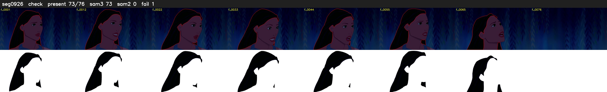

# Segment 926 (shot)

Film frames 81035-81110 (76 frames, 56:19.8-56:23.0).

**Status: check**

| | |
|---|---|
| Frames with her hair | 73 / 76 |
| Mask source | SAM3 73, SAM2 fallback 0 |
| Frames still failing QC | 1 [73] |
| Film indices with no picture (held) | 0 |
| Time | 110 s |

Top: source with the final mask outlined in red. Bottom: white-fill output.

## Issues

- other characters' hair erased on 1 frames
