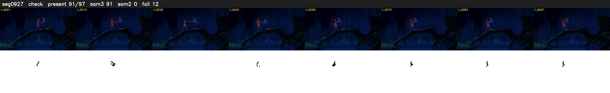

# Segment 927 (shot)

Film frames 81111-81207 (97 frames, 56:23.0-56:27.1).

**Status: check**

| | |
|---|---|
| Frames with her hair | 91 / 97 |
| Mask source | SAM3 91, SAM2 fallback 0 |
| Frames still failing QC | 12 [1, 2, 5, 6, 7, 8, 27, 28, 29, 30, 35, 36] |
| Film indices with no picture (held) | 0 |
| Time | 156 s |

Top: source with the final mask outlined in red. Bottom: white-fill output.

## Issues

- fallback 1-2: no seed prompts (cleaned seed too small (1919 px): hair lost)
- fallback 5-8: no seed prompts (cleaned seed too small (1915 px): hair lost)
- fallback 27-30: no seed prompts (cleaned seed too small (2134 px): hair lost)
- fallback 35-36: no seed prompts (cleaned seed too small (1696 px): hair lost)
