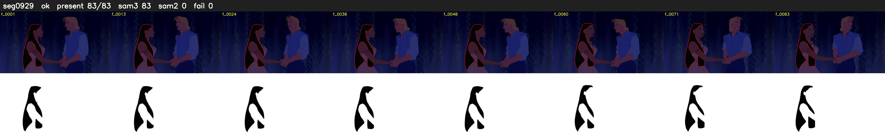

# Segment 929 (shot)

Film frames 81252-81334 (83 frames, 56:28.9-57:32.3).

**Status: ok**

| | |
|---|---|
| Frames with her hair | 83 / 83 |
| Mask source | SAM3 83, SAM2 fallback 0 |
| Frames still failing QC | 0 [] |
| Film indices with no picture (held) | 0 |
| Time | 125 s |

Top: source with the final mask outlined in red. Bottom: white-fill output.
