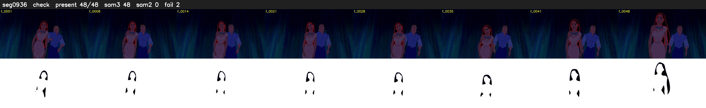

# Segment 936 (shot)

Film frames 81687-81734 (48 frames, 57:47.0-57:49.0).

**Status: check**

| | |
|---|---|
| Frames with her hair | 48 / 48 |
| Mask source | SAM3 48, SAM2 fallback 0 |
| Frames still failing QC | 2 [9, 10] |
| Film indices with no picture (held) | 0 |
| Time | 82 s |

Top: source with the final mask outlined in red. Bottom: white-fill output.

## Issues

- dark scene: 65% of frames fail 'missed', missed QC off
