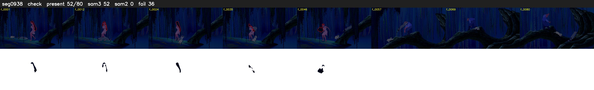

# Segment 938 (shot)

Film frames 81803-81882 (80 frames, 57:51.9-57:55.2).

**Status: check**

| | |
|---|---|
| Frames with her hair | 52 / 80 |
| Mask source | SAM3 52, SAM2 fallback 0 |
| Frames still failing QC | 36 [1, 2, 5, 6, 7, 8, 9, 10, 11, 12, 13, 14, 15, 16, 17, 18, 19, 20, 25, 33] |
| Film indices with no picture (held) | 0 |
| Time | 143 s |

Top: source with the final mask outlined in red. Bottom: white-fill output.

## Issues

- other characters' hair erased on 17 frames
