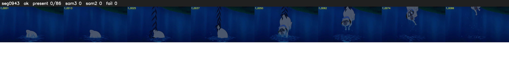

# Segment 943 (shot)

Film frames 82210-82295 (86 frames, 57:08.8-57:12.4).

**Status: ok**

| | |
|---|---|
| Frames with her hair | 0 / 86 |
| Mask source | SAM3 0, SAM2 fallback 0 |
| Frames still failing QC | 0 [] |
| Film indices with no picture (held) | 0 |
| Time | 147 s |

Top: source with the final mask outlined in red. Bottom: white-fill output.

## Issues

- other characters' hair erased on 81 frames
