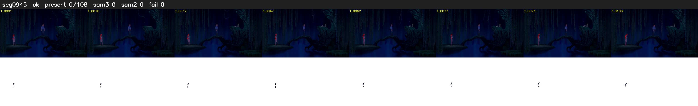

# Segment 945 (shot)

Film frames 82392-82499 (108 frames, 57:16.4-57:20.9).

**Status: ok**

| | |
|---|---|
| Frames with her hair | 0 / 108 |
| Mask source | SAM3 0, SAM2 fallback 0 |
| Frames still failing QC | 0 [] |
| Film indices with no picture (held) | 0 |
| Time | 197 s |

Top: source with the final mask outlined in red. Bottom: white-fill output.
