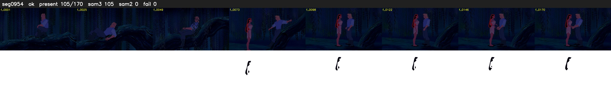

# Segment 954 (shot)

Film frames 83040-83209 (170 frames, 58:43.5-58:50.6).

**Status: ok**

| | |
|---|---|
| Frames with her hair | 105 / 170 |
| Mask source | SAM3 105, SAM2 fallback 0 |
| Frames still failing QC | 0 [] |
| Film indices with no picture (held) | 0 |
| Time | 267 s |

Top: source with the final mask outlined in red. Bottom: white-fill output.

## Issues

- other characters' hair erased on 64 frames
