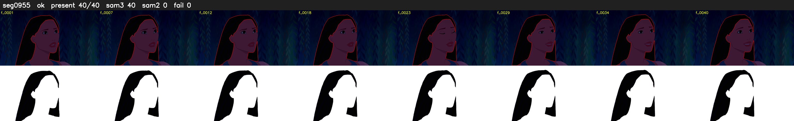

# Segment 955 (shot)

Film frames 83210-83249 (40 frames, 58:50.6-58:52.2).

**Status: ok**

| | |
|---|---|
| Frames with her hair | 40 / 40 |
| Mask source | SAM3 40, SAM2 fallback 0 |
| Frames still failing QC | 0 [] |
| Film indices with no picture (held) | 0 |
| Time | 59 s |

Top: source with the final mask outlined in red. Bottom: white-fill output.
