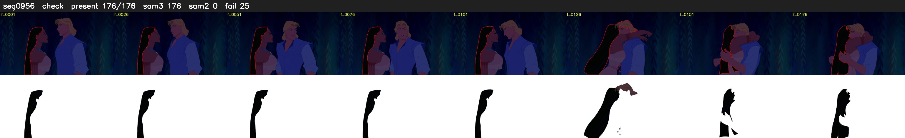

# Segment 956 (shot)

Film frames 83250-83425 (176 frames, 58:52.2-58:59.6).

**Status: check**

| | |
|---|---|
| Frames with her hair | 176 / 176 |
| Mask source | SAM3 176, SAM2 fallback 0 |
| Frames still failing QC | 25 [124, 126, 131, 132, 135, 136, 137, 139, 140, 141, 142, 143, 144, 145, 146, 147, 148, 149, 150, 151] |
| Film indices with no picture (held) | 0 |
| Time | 261 s |

Top: source with the final mask outlined in red. Bottom: white-fill output.
