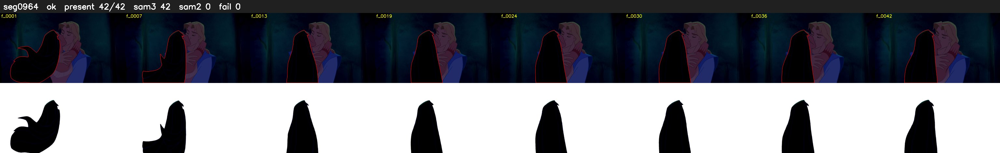

# Segment 964 (shot)

Film frames 84038-84079 (42 frames, 58:25.1-58:26.8).

**Status: ok**

| | |
|---|---|
| Frames with her hair | 42 / 42 |
| Mask source | SAM3 42, SAM2 fallback 0 |
| Frames still failing QC | 0 [] |
| Film indices with no picture (held) | 0 |
| Time | 64 s |

Top: source with the final mask outlined in red. Bottom: white-fill output.

## Issues

- dark scene: 100% of frames fail 'missed', missed QC off
