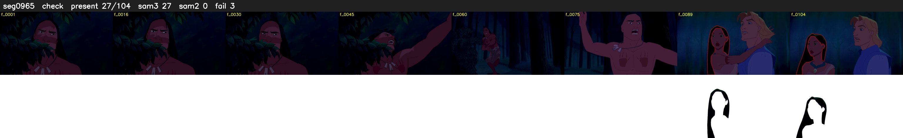

# Segment 965 (shot)

Film frames 84080-84183 (104 frames, 58:26.8-59:31.2).

**Status: check**

| | |
|---|---|
| Frames with her hair | 27 / 104 |
| Mask source | SAM3 27, SAM2 fallback 0 |
| Frames still failing QC | 3 [78, 101, 102] |
| Film indices with no picture (held) | 0 |
| Time | 166 s |

Top: source with the final mask outlined in red. Bottom: white-fill output.

## Issues

- other characters' hair erased on 77 frames
