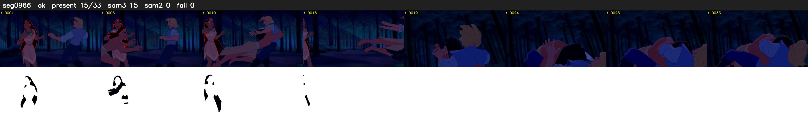

# Segment 966 (shot)

Film frames 84184-84216 (33 frames, 59:31.2-59:32.6).

**Status: ok**

| | |
|---|---|
| Frames with her hair | 15 / 33 |
| Mask source | SAM3 15, SAM2 fallback 0 |
| Frames still failing QC | 0 [] |
| Film indices with no picture (held) | 0 |
| Time | 60 s |

Top: source with the final mask outlined in red. Bottom: white-fill output.

## Issues

- dark scene: 93% of frames fail 'missed', missed QC off
- other characters' hair erased on 22 frames
