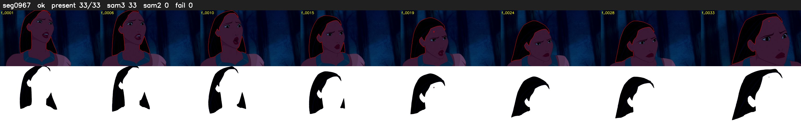

# Segment 967 (shot)

Film frames 84217-84249 (33 frames, 59:32.6-59:33.9).

**Status: ok**

| | |
|---|---|
| Frames with her hair | 33 / 33 |
| Mask source | SAM3 33, SAM2 fallback 0 |
| Frames still failing QC | 0 [] |
| Film indices with no picture (held) | 0 |
| Time | 50 s |

Top: source with the final mask outlined in red. Bottom: white-fill output.

## Issues

- dark scene: 97% of frames fail 'missed', missed QC off
