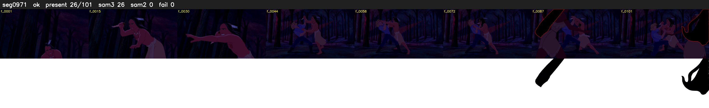

# Segment 971 (shot)

Film frames 84342-84442 (101 frames, 59:37.8-59:42.0).

**Status: ok**

| | |
|---|---|
| Frames with her hair | 26 / 101 |
| Mask source | SAM3 26, SAM2 fallback 0 |
| Frames still failing QC | 0 [] |
| Film indices with no picture (held) | 0 |
| Time | 170 s |

Top: source with the final mask outlined in red. Bottom: white-fill output.

## Issues

- dark scene: 85% of frames fail 'missed', missed QC off
- other characters' hair erased on 92 frames
