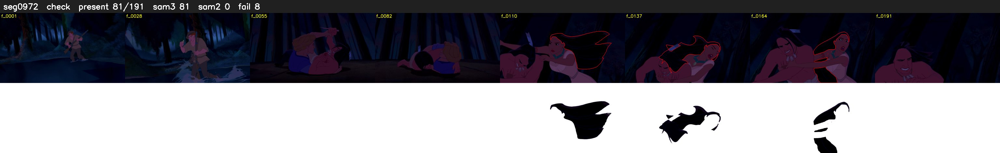

# Segment 972 (shot)

Film frames 84443-84633 (191 frames, 59:42.0-59:49.9).

**Status: check**

| | |
|---|---|
| Frames with her hair | 81 / 191 |
| Mask source | SAM3 81, SAM2 fallback 0 |
| Frames still failing QC | 8 [100, 118, 140, 160, 172, 178, 180, 181] |
| Film indices with no picture (held) | 0 |
| Time | 355 s |

Top: source with the final mask outlined in red. Bottom: white-fill output.

## Issues

- other characters' hair erased on 158 frames
