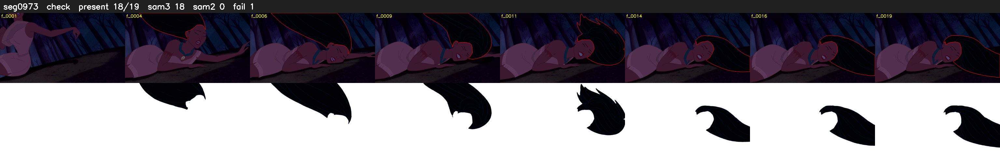

# Segment 973 (shot)

Film frames 84634-84652 (19 frames, 59:49.9-59:50.7).

**Status: check**

| | |
|---|---|
| Frames with her hair | 18 / 19 |
| Mask source | SAM3 18, SAM2 fallback 0 |
| Frames still failing QC | 1 [2] |
| Film indices with no picture (held) | 0 |
| Time | 30 s |

Top: source with the final mask outlined in red. Bottom: white-fill output.

## Issues

- dark scene: 78% of frames fail 'missed', missed QC off
- other characters' hair erased on 1 frames
