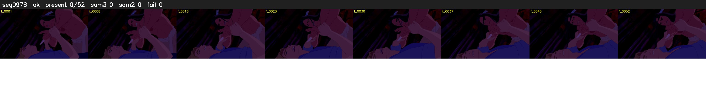

# Segment 978 (shot)

Film frames 84799-84850 (52 frames, 59:56.8-59:59.0).

**Status: ok**

| | |
|---|---|
| Frames with her hair | 0 / 52 |
| Mask source | SAM3 0, SAM2 fallback 0 |
| Frames still failing QC | 0 [] |
| Film indices with no picture (held) | 0 |
| Time | 90 s |

Top: source with the final mask outlined in red. Bottom: white-fill output.

## Issues

- other characters' hair erased on 52 frames
