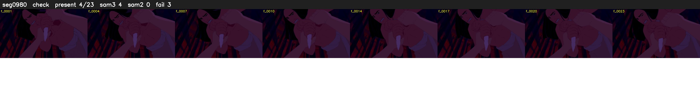

# Segment 980 (shot)

Film frames 84895-84917 (23 frames, 59:00.8-59:01.8).

**Status: check**

| | |
|---|---|
| Frames with her hair | 4 / 23 |
| Mask source | SAM3 4, SAM2 fallback 0 |
| Frames still failing QC | 3 [3, 4, 5] |
| Film indices with no picture (held) | 0 |
| Time | 47 s |

Top: source with the final mask outlined in red. Bottom: white-fill output.

## Issues

- dark scene: 75% of frames fail 'missed', missed QC off
- other characters' hair erased on 20 frames
