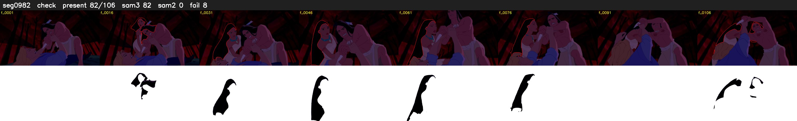

# Segment 982 (shot)

Film frames 84966-85071 (106 frames, 59:03.8-59:08.2).

**Status: check**

| | |
|---|---|
| Frames with her hair | 82 / 106 |
| Mask source | SAM3 82, SAM2 fallback 0 |
| Frames still failing QC | 8 [7, 8, 9, 10, 11, 12, 84, 103] |
| Film indices with no picture (held) | 0 |
| Time | 234 s |

Top: source with the final mask outlined in red. Bottom: white-fill output.

## Issues

- other characters' hair erased on 94 frames
