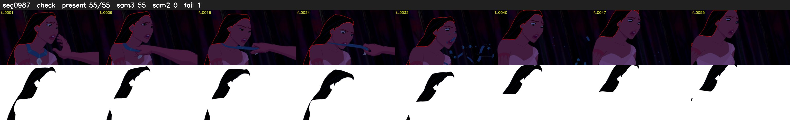

# Segment 987 (shot)

Film frames 85168-85222 (55 frames, 59:12.2-59:14.5).

**Status: check**

| | |
|---|---|
| Frames with her hair | 55 / 55 |
| Mask source | SAM3 55, SAM2 fallback 0 |
| Frames still failing QC | 1 [51] |
| Film indices with no picture (held) | 0 |
| Time | 100 s |

Top: source with the final mask outlined in red. Bottom: white-fill output.
