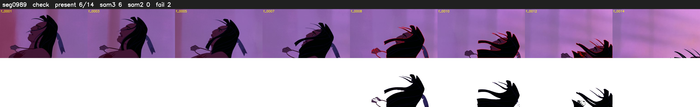

# Segment 989 (shot)

Film frames 85239-85252 (14 frames, 59:15.2-59:15.8).

**Status: check**

| | |
|---|---|
| Frames with her hair | 6 / 14 |
| Mask source | SAM3 6, SAM2 fallback 0 |
| Frames still failing QC | 2 [8, 13] |
| Film indices with no picture (held) | 0 |
| Time | 24 s |

Top: source with the final mask outlined in red. Bottom: white-fill output.

## Issues

- other characters' hair erased on 8 frames
