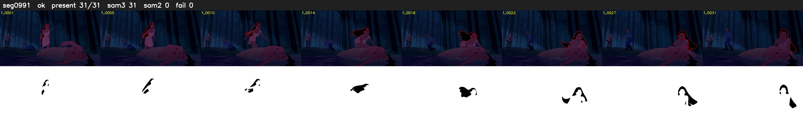

# Segment 991 (shot)

Film frames 85307-85337 (31 frames, 59:18.0-59:19.3).

**Status: ok**

| | |
|---|---|
| Frames with her hair | 31 / 31 |
| Mask source | SAM3 31, SAM2 fallback 0 |
| Frames still failing QC | 0 [] |
| Film indices with no picture (held) | 0 |
| Time | 66 s |

Top: source with the final mask outlined in red. Bottom: white-fill output.

## Issues

- dark scene: 94% of frames fail 'missed', missed QC off
- other characters' hair erased on 31 frames
