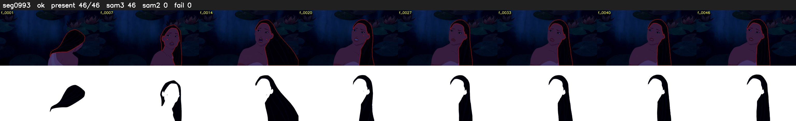

# Segment 993 (shot)

Film frames 85389-85434 (46 frames, 59:21.4-59:23.4).

**Status: ok**

| | |
|---|---|
| Frames with her hair | 46 / 46 |
| Mask source | SAM3 46, SAM2 fallback 0 |
| Frames still failing QC | 0 [] |
| Film indices with no picture (held) | 0 |
| Time | 70 s |

Top: source with the final mask outlined in red. Bottom: white-fill output.

## Issues

- dark scene: 76% of frames fail 'missed', missed QC off
