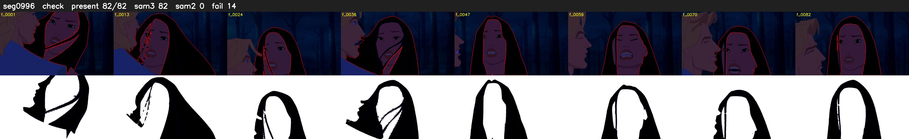

# Segment 996 (shot)

Film frames 85483-85564 (82 frames, 59:25.4-59:28.8).

**Status: check**

| | |
|---|---|
| Frames with her hair | 82 / 82 |
| Mask source | SAM3 82, SAM2 fallback 0 |
| Frames still failing QC | 14 [3, 4, 6, 11, 13, 14, 40, 63, 64, 67, 69, 70, 71, 74] |
| Film indices with no picture (held) | 0 |
| Time | 166 s |

Top: source with the final mask outlined in red. Bottom: white-fill output.

## SAM2 fallbacks

| Frames | Anchor | Direction | SAM2 used |
|---|---|---|---|
| 3-4 | 2 | forward | 0/2 |
| 6-6 | 5 | forward | 0/1 |
| 11-11 | 10 | forward | 0/1 |
| 13-14 | 12 | forward | 0/2 |
| 40-40 | 39 | forward | 0/1 |
| 63-64 | 62 | forward | 0/2 |
| 67-67 | 66 | forward | 0/1 |
| 69-71 | 68 | forward | 0/3 |
| 74-74 | 73 | forward | 0/1 |
