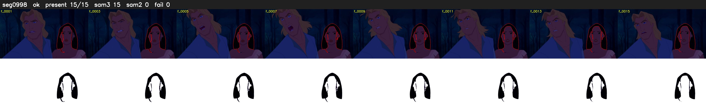

# Segment 998 (shot)

Film frames 85663-85677 (15 frames, 60:32.9-60:33.5).

**Status: ok**

| | |
|---|---|
| Frames with her hair | 15 / 15 |
| Mask source | SAM3 15, SAM2 fallback 0 |
| Frames still failing QC | 0 [] |
| Film indices with no picture (held) | 0 |
| Time | 24 s |

Top: source with the final mask outlined in red. Bottom: white-fill output.

## Issues

- dark scene: 100% of frames fail 'missed', missed QC off
