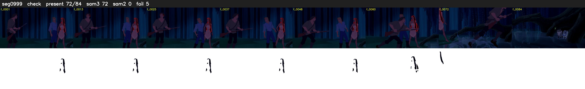

# Segment 999 (shot)

Film frames 85678-85761 (84 frames, 60:33.5-60:37.0).

**Status: check**

| | |
|---|---|
| Frames with her hair | 72 / 84 |
| Mask source | SAM3 72, SAM2 fallback 0 |
| Frames still failing QC | 5 [53, 54, 63, 64, 71] |
| Film indices with no picture (held) | 0 |
| Time | 132 s |

Top: source with the final mask outlined in red. Bottom: white-fill output.

## Issues

- other characters' hair erased on 7 frames
