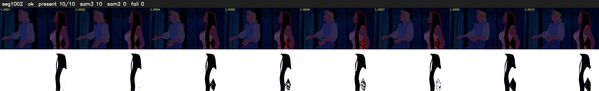

# Segment 1002 (shot)

Film frames 85893-85902 (10 frames, 60:42.5-60:42.9).

**Status: ok**

| | |
|---|---|
| Frames with her hair | 10 / 10 |
| Mask source | SAM3 10, SAM2 fallback 0 |
| Frames still failing QC | 0 [] |
| Film indices with no picture (held) | 0 |
| Time | 16 s |

Top: source with the final mask outlined in red. Bottom: white-fill output.

## Issues

- dark scene: 100% of frames fail 'missed', missed QC off
