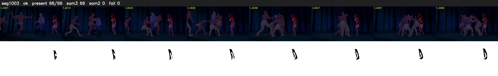

# Segment 1003 (shot)

Film frames 85903-85968 (66 frames, 60:42.9-60:45.6).

**Status: ok**

| | |
|---|---|
| Frames with her hair | 66 / 66 |
| Mask source | SAM3 66, SAM2 fallback 0 |
| Frames still failing QC | 0 [] |
| Film indices with no picture (held) | 0 |
| Time | 198 s |

Top: source with the final mask outlined in red. Bottom: white-fill output.

## Issues

- other characters' hair erased on 66 frames
