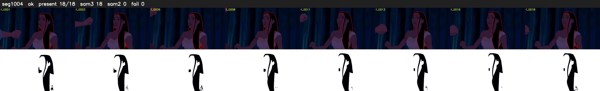

# Segment 1004 (shot)

Film frames 85969-85986 (18 frames, 60:45.6-60:46.4).

**Status: ok**

| | |
|---|---|
| Frames with her hair | 18 / 18 |
| Mask source | SAM3 18, SAM2 fallback 0 |
| Frames still failing QC | 0 [] |
| Film indices with no picture (held) | 0 |
| Time | 27 s |

Top: source with the final mask outlined in red. Bottom: white-fill output.

## Issues

- dark scene: 100% of frames fail 'missed', missed QC off
