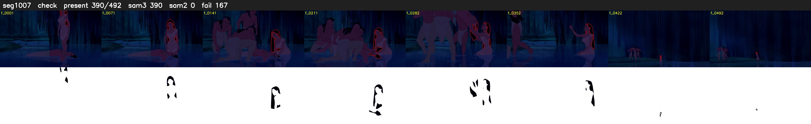

# Segment 1007 (shot)

Film frames 86066-86557 (492 frames, 60:49.7-60:10.2).

**Status: check**

| | |
|---|---|
| Frames with her hair | 390 / 492 |
| Mask source | SAM3 390, SAM2 fallback 0 |
| Frames still failing QC | 167 [3, 6, 29, 30, 33, 35, 36, 37, 38, 39, 40, 41, 42, 43, 44, 47, 48, 49, 50, 51] |
| Film indices with no picture (held) | 0 |
| Time | 1245 s |

Top: source with the final mask outlined in red. Bottom: white-fill output.

## Issues

- manual override: SAM2 fallback spilled onto her body/water (f201, f390); identity tracks all P>0.7, so keep SAM3
- other characters' hair erased on 373 frames
