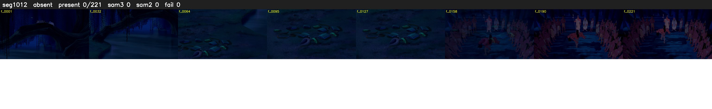

# Segment 1012 (shot)

Film frames 86953-87173 (221 frames, 60:26.7-61:35.9).

**Status: absent**

| | |
|---|---|
| Frames with her hair | 0 / 221 |
| Mask source | SAM3 0, SAM2 fallback 0 |
| Frames still failing QC | 0 [] |
| Film indices with no picture (held) | 0 |
| Time | 92 s |

Top: source with the final mask outlined in red. Bottom: white-fill output.

## Issues

- hair on 35/37 presence frames, none of it hers (best P 0.04)
