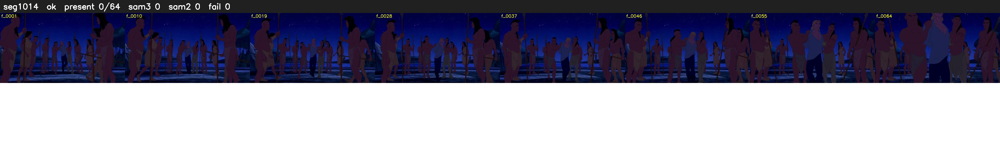

# Segment 1014 (shot)

Film frames 87296-87359 (64 frames, 61:41.0-61:43.6).

**Status: ok**

| | |
|---|---|
| Frames with her hair | 0 / 64 |
| Mask source | SAM3 0, SAM2 fallback 0 |
| Frames still failing QC | 0 [] |
| Film indices with no picture (held) | 0 |
| Time | 233 s |

Top: source with the final mask outlined in red. Bottom: white-fill output.

## Issues

- other characters' hair erased on 64 frames
