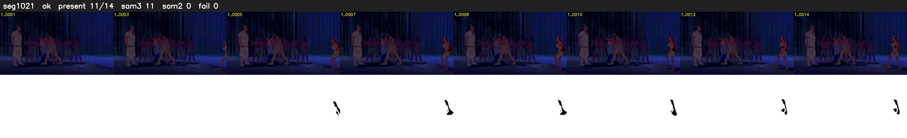

# Segment 1021 (shot)

Film frames 87654-87667 (14 frames, 61:55.9-61:56.5).

**Status: ok**

| | |
|---|---|
| Frames with her hair | 11 / 14 |
| Mask source | SAM3 11, SAM2 fallback 0 |
| Frames still failing QC | 0 [] |
| Film indices with no picture (held) | 0 |
| Time | 54 s |

Top: source with the final mask outlined in red. Bottom: white-fill output.

## Issues

- other characters' hair erased on 14 frames
