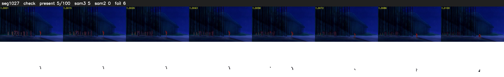

# Segment 1027 (shot)

Film frames 88112-88211 (100 frames, 61:15.0-61:19.2).

**Status: check**

| | |
|---|---|
| Frames with her hair | 5 / 100 |
| Mask source | SAM3 5, SAM2 fallback 0 |
| Frames still failing QC | 6 [51, 52, 53, 54, 55, 56] |
| Film indices with no picture (held) | 0 |
| Time | 364 s |

Top: source with the final mask outlined in red. Bottom: white-fill output.

## Issues

- fallback 51-56: no seed prompts (cleaned seed too small (1584 px): hair lost)
- other characters' hair erased on 12 frames
