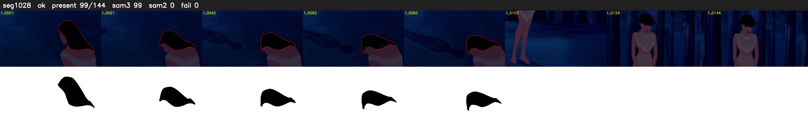

# Segment 1028 (shot)

Film frames 88212-88355 (144 frames, 61:19.2-61:25.2).

**Status: ok**

| | |
|---|---|
| Frames with her hair | 99 / 144 |
| Mask source | SAM3 99, SAM2 fallback 0 |
| Frames still failing QC | 0 [] |
| Film indices with no picture (held) | 0 |
| Time | 230 s |

Top: source with the final mask outlined in red. Bottom: white-fill output.

## Issues

- other characters' hair erased on 41 frames
