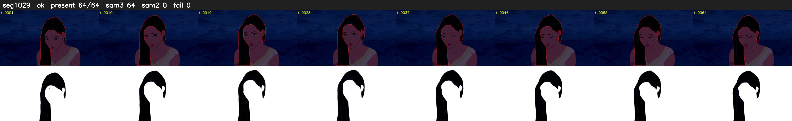

# Segment 1029 (shot)

Film frames 88356-88419 (64 frames, 61:25.2-61:27.9).

**Status: ok**

| | |
|---|---|
| Frames with her hair | 64 / 64 |
| Mask source | SAM3 64, SAM2 fallback 0 |
| Frames still failing QC | 0 [] |
| Film indices with no picture (held) | 0 |
| Time | 96 s |

Top: source with the final mask outlined in red. Bottom: white-fill output.
