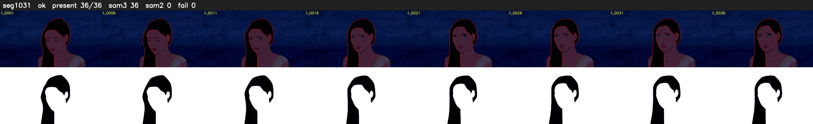

# Segment 1031 (shot)

Film frames 88539-88574 (36 frames, 62:32.8-62:34.3).

**Status: ok**

| | |
|---|---|
| Frames with her hair | 36 / 36 |
| Mask source | SAM3 36, SAM2 fallback 0 |
| Frames still failing QC | 0 [] |
| Film indices with no picture (held) | 0 |
| Time | 54 s |

Top: source with the final mask outlined in red. Bottom: white-fill output.
